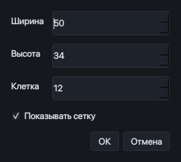

# Пояснительная записка

**Название проекта:** Лаборатория клеточных автоматов

**Автор:** Сарычев Семён Александрович

## Описание программы
Десктопная программа на Python с графическим интерфейсом PyQt6 для наблюдения и исследования клеточных автоматов. В основе приложения лежит игра "Жизнь" Джона Конвея, а также другие классические правила клеточных автоматов.

## Техническое задание

Название программы: Лаборатория клеточных автоматов (Cellular Automata Lab).

Назначение: программа показывает, как меняется сетка клеточного автомата от поколения к поколению по выбранному правилу, и позволяет сохранять и загружать конфигурации поля и свои правила.

Область применения: учёба, уроки информатики, защита проекта, самостоятельные эксперименты с правилами.

Язык программирования: Python 3.10 и выше.

Библиотека GUI: PyQt6.

Другие библиотеки: sqlite3, json, csv, numpy.

### Что должна уметь программа

1. Создавать поле от 10x10 до 300x300 клеток.
2. Рисовать живые клетки закрашенными, а мёртвые оставлять фоном. Сетку можно включать и выключать, масштаб менять.
3. Запускать и останавливать симуляцию, делать один шаг, сбрасывать поле, заполнять его случайно с выбранной плотностью.
4. Менять скорость от 1 до 60 поколений в секунду.
5. Показывать номер поколения и число живых клеток.
6. Давать рисовать мышью: клик или протяжка ставит и убирает клетки.
7. Выбирать правило из списка: Жизнь Конвея, HighLife, Day & Night, Seeds, Brain и другие.
8. Вводить своё правило в записи B/S, например B3/S23.
9. Сохранять и загружать поле в JSON и CSV.
10. Хранить конфигурации в базе SQLite: название, размер поля, правило, дата. Их можно загрузить или удалить.
11. Вставлять готовые фигуры: глайдер, пульсар, LWSS и другие.
12. Показывать, как менялась популяция по поколениям, в таблице и на графике, и выгружать это в CSV.
13. Сохранять картинку поля в PNG.
14. Показывать справку по правилам и окно "О программе".

### Как должно выглядеть окно

1. Главное окно с заголовком "Лаборатория клеточных автоматов". Размер можно менять, но меньше 900x600 оно не становится.
2. Сверху меню: Файл, Правка, Симуляция, Справка.
3. Панель управления: кнопки старт/пауза, шаг, сброс, случайное заполнение. Размер поля и скорость задаются через QSpinBox, плотность через QSlider, правило выбирается в QComboBox или вводится в QLineEdit.
4. Само поле рисуется в отдельном виджете через paintEvent, стоит в центре окна, его можно прокручивать и масштабировать.
5. Сбоку вкладки на QTabWidget: правила, паттерны, сохранённые, статистика. Паттерны и сохранённые конфигурации показываются в таблицах QTableWidget.
6. Описание правила и справка выводятся в QTextBrowser.
7. Для выбора файлов используется QFileDialog, для сообщений QMessageBox, для ввода названия конфигурации QInputDialog.
8. На кнопках есть иконки, кнопка старт/пауза выделяется цветом.
9. Вёрстка на QVBoxLayout, QHBoxLayout, QGridLayout и QSplitter, при растягивании окна ничего не ломается.
10. Шрифт один и читаемый, можно сделать светлую и тёмную тему.

### Ошибки и надёжность

1. Правило проверяется: только цифры 0-8 и формат B.../S.... Если ввели неправильно, появляется QMessageBox "Некорректное правило", а старое правило остаётся.
2. Размер поля ограничен 10-300, плотность 0-100, выйти за границы нельзя, QSpinBox и QSlider не дадут.
3. Если файл битый или его нет, ошибка чтения перехватывается и появляется сообщение "Не удалось загрузить файл". Программа не падает.
4. Ошибки базы перехватываются через sqlite3.Error, показывается "Ошибка базы данных", операцию можно повторить.
5. Если поле изменено и не сохранено, перед сбросом и выходом программа спрашивает подтверждение.
6. Пока идёт симуляция, окно не должно замирать, расчёт идёт по таймеру.

## Реализация

Проект собирается через uv, код лежит в src/life_lab. Внутри два пакета: core с правилами и ui с интерфейсом.

Правила записаны строками вида B3/S23. Функция parse делит строку по слэшу и делает два множества: при скольких соседях клетка рождается и при скольких выживает.

Поле это класс Field на QWidget, состояние хранится в списке списков: 1 живая клетка, 0 мёртвая. В paintEvent рисуются фон, сетка и живые клетки. Левой кнопкой мыши клетка ставится, правой стирается.

Поколение считает step. Для каждой клетки count складывает восемь соседей, края заворачиваются. Дальше правило решает, будет клетка живой или мёртвой, и новая сетка заменяет старую.

Окно Win хранит поле, таймер и номер поколения. Таймер раз в 1000/v миллисекунд вызывает tick, тот делает шаг и обновляет строку состояния. Кнопки и меню вызывают те же методы, что и таймер.

Настройки поля открывает диалог Settings: ширина, высота, размер клетки, правило и сетка. После ОК поле пересоздаётся, счётчик поколений обнуляется. Оформление лежит в ui/style.py.

## Запуск

Нужен Python 3.10 или новее. Если есть uv, в папке проекта:

```
uv sync
uv run life-lab
```

Второй вариант запуска: `uv run python -m life_lab`.

### Без uv

Если uv нет, хватит Python и pip.

Windows:

```
python -m venv .venv
.venv\Scripts\activate
pip install .
life-lab
```

Linux и macOS:

```
python3 -m venv .venv
source .venv/bin/activate
pip install .
life-lab
```

Вместо `life-lab` можно запустить `python -m life_lab`. Выйти из окружения: `deactivate`. Если pip старый, перед установкой стоит обновить его: `python -m pip install --upgrade pip`.

## Интерфейс

Сверху меню: Файл, Симуляция, Справка. Под ним панель управления с кнопками Старт, Шаг, Сброс, Случайно. Справа скорость и выбор правила. Внизу строка состояния с номером поколения и числом живых клеток.


Диалог настроек открывается через Файл, Новое поле. В нём ширина и высота поля, размер клетки, правило и переключатель сетки.



Поле можно рисовать мышью: левая кнопка ставит клетку, правая стирает, протяжка с зажатой кнопкой красит несколько клеток подряд.

## Проверка работы

| Что проверял | Как проверял | Результат |
|---|---|---|
| Запуск | uv run life-lab | окно открывается |
| Правило | выбрал HighLife | рождения {3, 6}, выживание {2, 3} |
| Шаг | мигалка из трёх клеток | за шаг повернулась, за второй вернулась |
| Старт и пауза | нажал кнопку два раза | таймер запускается и останавливается |
| Сброс | заполнил поле и нажал Сброс | поле пустое, поколение 0 |
| Случайное заполнение | нажал Случайно на поле 10x10 | живых 37 из 100 |
| Мышь | клик левой и правой кнопкой | клетка ставится и стирается |
| Размер поля | поменял 10x10 на 30x20 | поле 300x200, сетка включена |
| Скорость | поставил 20 | интервал таймера 50 мс |

## Заключение

Получилась работающая версия программы: поле с настройками, пять правил, ручное рисование, запуск и остановка симуляции, смена размера и тёмное оформление. Все проверки из таблицы проходят.

В ТЗ записано больше, чем успел сделать: сохранение в JSON, CSV и базу SQLite, библиотека паттернов, статистика и экспорт PNG. Это следующие шаги.

Во время работы разобрался с сигналами и слотами в PyQt6, компоновками, рисованием через paintEvent и таймером. Отдельно понял, как считается поколение клеточного автомата и почему новую сетку нужно считать отдельно от старой.

## Источники

1. Гарднер М. Математические досуги. М.: Мир, 1972.
2. LifeWiki. Правила в нотации B/S. https://conwaylife.com/wiki
3. Документация PyQt6. https://doc.qt.io/qtforpython-6
4. Документация uv. https://docs.astral.sh/uv
