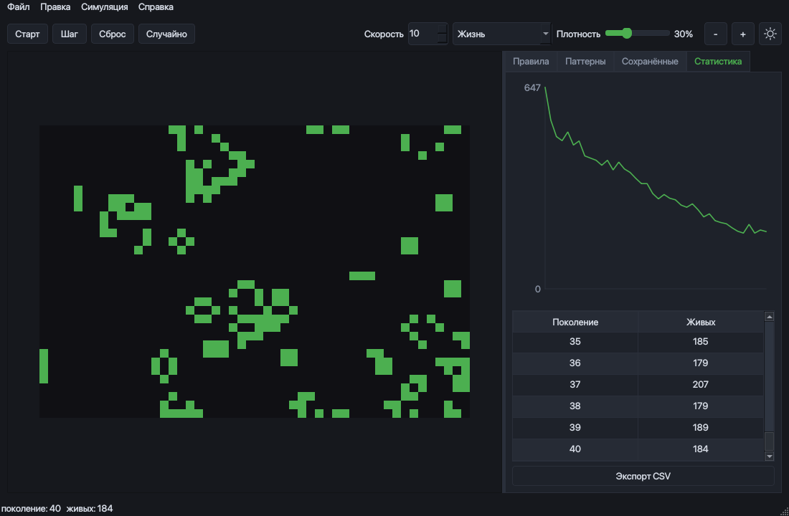
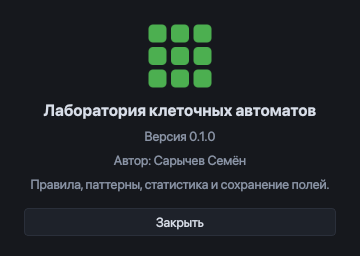

# Пояснительная записка

**Название проекта:** Лаборатория клеточных автоматов

**Автор:** Сарычев Семён Александрович

## Описание программы

Десктопная программа на Python с графическим интерфейсом PyQt6 для наблюдения и исследования клеточных автоматов. В основе приложения лежит игра "Жизнь" Джона Конвея, а также другие классические правила клеточных автоматов.

## Техническое задание

Название программы: Лаборатория клеточных автоматов (Cellular Automata Lab).

Назначение: программа показывает, как меняется сетка клеточного автомата от поколения к поколению по выбранному правилу, и позволяет сохранять и загружать конфигурации поля, свои правила и результаты экспериментов.

Область применения: учёба, уроки информатики, защита проекта, самостоятельные эксперименты с правилами.

Язык программирования: Python 3.10 и выше.

Библиотека GUI: PyQt6.

Другие библиотеки: sqlite3, json, csv.

### Что должна уметь программа

1. Создавать поле от 10x10 до 300x300 клеток.
2. Рисовать живые клетки закрашенными, а мёртвые оставлять фоном. Сетку можно включать и выключать, масштаб менять.
3. Запускать и останавливать симуляцию, делать один шаг, сбрасывать поле, заполнять его случайно с выбранной плотностью.
4. Менять скорость от 1 до 60 поколений в секунду.
5. Показывать номер поколения и число живых клеток.
6. Давать рисовать мышью: клик или протяжка ставит и убирает клетки.
7. Выбирать правило из списка: Жизнь Конвея, HighLife, Day & Night, Seeds, Brain, Replicator, Жизнь без смерти.
8. Вводить своё правило в записи B/S, например B3/S23.
9. Сохранять и загружать поле в JSON и CSV.
10. Хранить конфигурации в базе SQLite: название, размер поля, правило, дата. Их можно загрузить, перезаписать или удалить.
11. Хранить настройки программы в отдельной таблице SQLite. Сейчас там сохраняется выбранная тема.
12. Вставлять готовые фигуры: глайдер, LWSS, пульсар, блок, мигалку, жабу и R-пентомино.
13. Показывать, как менялась популяция по поколениям, в таблице и на графике, и выгружать это в CSV.
14. Сохранять картинку поля в PNG.
15. Показывать справку по правилам и отдельное окно О программе.
16. Переключать светлую и тёмную тему. Выбранная тема сохраняется и восстанавливается при следующем запуске.

### Как должно выглядеть окно

1. Главное окно с заголовком "Лаборатория клеточных автоматов". Размер можно менять, но меньше 900x600 оно не становится.
2. Сверху меню: Файл, Правка, Симуляция, Справка.
3. Панель управления: кнопки старт/пауза, шаг, сброс, случайное заполнение. Скорость задаётся через QSpinBox, правило выбирается в QComboBox, плотность через QSlider с процентами. Есть кнопки масштаба и кнопка темы.
4. Само поле рисуется в отдельном виджете через paintEvent, стоит в центре окна, его можно прокручивать и масштабировать.
5. Сбоку вкладки на QTabWidget: правила, паттерны, сохранённые, статистика. Паттерны и сохранённые конфигурации показываются в таблицах QTableWidget.
6. Описание правила и справка выводятся в QTextBrowser.
7. Для выбора файлов используется QFileDialog, для сообщений QMessageBox, для ввода названия конфигурации QInputDialog.
8. Кнопка темы показывает солнце или луну. Остальные кнопки текстовые, кнопка старт/пауза выделяется цветом.
9. Вёрстка на QVBoxLayout, QHBoxLayout и QSplitter, поле прокручивается в QScrollArea, при растягивании окна ничего не ломается.
10. Шрифт один и читаемый, есть светлая и тёмная тема, основной цвет зелёный.
11. Настройки поля открываются в отдельном диалоге: ширина, высота, размер клетки и переключатель сетки.
12. О программе открывается в отдельном окне с логотипом, версией и автором.

### Ошибки и надёжность

1. Правило проверяется: только цифры 0-8 и формат B.../S.... Если ввели неправильно, появляется QMessageBox "Некорректное правило", а старое правило остаётся.
2. Размер поля ограничен 10-300, плотность 0-100, скорость 1-60. QSpinBox и QSlider не дают выйти за границы.
3. JSON проверяется по ключам, размерам, правилу и координатам клеток.
4. CSV проверяется через модуль csv: все строки одной длины, значения только 0 и 1, размер поля 10-300.
5. Если файл битый, его нет или он не того формата, ошибка чтения перехватывается и появляется сообщение "Не удалось загрузить файл". Программа не падает.
6. Ошибки базы перехватываются через sqlite3.Error, показывается "Ошибка базы данных".
7. Если поле изменено и не сохранено, перед сбросом, загрузкой и выходом программа спрашивает подтверждение.
8. Пока идёт симуляция, окно не замирает, расчёт идёт по таймеру.

## Реализация

Проект собирается через uv или pip, код лежит в src/life_lab. Внутри пакеты core и ui, а также папка assets с картинками.

Правила записаны строками вида B3/S23. Функция parse делит строку по слэшу и делает два множества: при скольких соседях клетка рождается и при скольких выживает.

Поле это класс Field на QWidget, состояние хранится в списке списков: 1 живая клетка, 0 мёртвая. В paintEvent рисуются фон, сетка и живые клетки. Левой кнопкой мыши клетка ставится, правой стирается, протяжка красит линию.

Поколение считает step. Для каждой клетки count складывает восемь соседей, края заворачиваются. Дальше правило решает, будет клетка живой или мёртвой, и новая сетка заменяет старую.

Окно Win хранит поле, таймер и номер поколения. Таймер раз в 1000/v миллисекунд вызывает tick, тот делает шаг, добавляет точку в статистику и обновляет строку состояния. Кнопки и меню вызывают те же методы, что и таймер.

Настройки поля открывает диалог Settings: ширина, высота, размер клетки и сетка. После ОК поле пересоздаётся, счётчик поколений обнуляется. Правило выбирается в главном окне.

Работа с файлами лежит в core/io.py. JSON хранит размер поля, правило и список координат живых клеток. CSV это матрица из 0 и 1, для чтения и записи используется модуль csv.

База данных лежит в ~/.life-lab/life.db. В ней две таблицы: configs для сохранённых полей и settings для настроек. Сохранение поля с тем же названием перезаписывает запись через ON CONFLICT. Тема сохраняется в settings и читается при запуске.

Статистика это отдельный виджет: таблица поколений и график на QPainter. График показывает число живых клеток, таблица хранит последние 500 строк. Экспорт статистики пишется в CSV через модуль csv с разделителем ;.

Паттерны хранятся в core/patterns.py. Их семь: глайдер, LWSS, пульсар, блок, мигалка, жаба и R-пентомино. Фигура вставляется в центр поля.

Оформление лежит в ui/style.py. Тёмная и светлая темы, зелёный акцент. Иконки солнца и луны, логотип и иконка окна взяты из Bootstrap Icons, лицензия MIT.

О программе это отдельный диалог ui/about.py с логотипом и версией.

Зависимости записаны в requirements.txt. Объём кода около 1450 строк.

## Запуск

Нужен Python 3.10 или новее. Если есть uv, в папке проекта:

```
uv sync
uv run life-lab
```

Второй вариант запуска: `uv run python -m life_lab`.

### Без uv

Если uv нет, хватит Python и pip.

Windows:

```
python -m venv .venv
.venv\Scripts\activate
pip install -r requirements.txt
pip install .
life-lab
```

Linux и macOS:

```
python3 -m venv .venv
source .venv/bin/activate
pip install -r requirements.txt
pip install .
life-lab
```

Вместо `life-lab` можно запустить `python -m life_lab`. Выйти из окружения: `deactivate`. Если pip старый, перед установкой стоит обновить его: `python -m pip install --upgrade pip`.

## Интерфейс

Сверху меню: Файл, Правка, Симуляция, Справка. Под ним панель управления с кнопками Старт, Шаг, Сброс, Случайно. Справа скорость, выбор правила, плотность случайного заполнения, масштаб и кнопка темы. Внизу строка состояния с номером поколения и числом живых клеток.



Диалог настроек открывается через Файл, Новое поле. В нём ширина и высота поля, размер клетки и переключатель сетки.


Окно О программе открывается через Справка, О программе. В нём логотип, версия и автор.



Поле можно рисовать мышью: левая кнопка ставит клетку, правая стирает, протяжка с зажатой кнопкой красит несколько клеток подряд.

Тема переключается кнопкой с солнцем или луной, а также через меню Справка, Темная тема. Выбор сохраняется в базе и не сбрасывается после перезапуска.

## Проверка работы

| Что проверял | Как проверял | Результат |
|---|---|---|
| Запуск | uv run life-lab | окно открывается |
| Правило | выбрал HighLife | рождения {3, 6}, выживание {2, 3} |
| Своё правило | ввёл B3/S23 | правило применилось, поле считается |
| Шаг | мигалка из трёх клеток | за шаг повернулась, за второй вернулась |
| Старт и пауза | нажал кнопку два раза | таймер запускается и останавливается |
| Сброс | заполнил поле и нажал Сброс | поле пустое, поколение 0 |
| Случайное заполнение | нажал Случайно на поле 10x10 | живые клетки появились, плотность учитывается |
| Мышь | клик левой и правой кнопкой | клетка ставится и стирается |
| Размер поля | поменял 10x10 на 30x20 | поле 360x240 при клетке 12, сетка включена |
| Скорость | поставил 20 | интервал таймера 50 мс |
| Паттерны | вставил глайдер | фигура появилась и двигается |
| JSON | сохранил и открыл поле | размер, правило и клетки совпали |
| CSV | сохранил и открыл поле | матрица 0 и 1 совпала |
| База данных | сохранил конфигурацию | запись появилась в таблице Сохранённые |
| Чтение из БД | перезапустил программу | конфигурация осталась на месте |
| Изменение в БД | сохранил поле с тем же названием | запись обновилась, дубликата нет |
| Настройки в БД | переключил тему и перезапустил | тема осталась прежней |
| Статистика | запустил симуляцию | таблица и график обновились |
| Экспорт статистики | нажал Экспорт CSV | файл с заголовком поколение;живых |
| PNG | нажал Экспорт PNG | картинка поля сохранилась |
| Темы | переключил тему | цвета и иконка сменились |
| О программе | открыл через Справка | окно с логотипом и версией открылось |

## Заключение

Получилась работающая версия программы: поле с настройками, семь правил и ввод своего правила, ручное рисование, запуск и остановка симуляции, паттерны, сохранение в JSON и CSV, база SQLite с двумя таблицами, статистика с графиком и экспортом, PNG и две темы с запоминанием выбора.

Все пункты технического задания выполнены. Отдельно сделаны требования к технологиям: requirements.txt, несколько форм, стандартные диалоги, картинки, файлы CSV, несколько таблиц в базе, чтение, запись и изменение данных.

Во время работы разобрался с сигналами и слотами в PyQt6, компоновками, рисованием через paintEvent, таймером QTimer, работой с SQLite и модулем csv. Отдельно понял, как считается поколение клеточного автомата и почему новую сетку нужно считать отдельно от старой.

## Источники

1. Гарднер М. Математические досуги. М.: Мир, 1972.
2. LifeWiki. Правила в нотации B/S. https://conwaylife.com/wiki
3. Документация PyQt6. https://doc.qt.io/qtforpython-6
4. Документация uv. https://docs.astral.sh/uv
5. Bootstrap Icons. https://icons.getbootstrap.com
6. Bootstrap Icons, репозиторий и лицензия MIT. https://github.com/twbs/icons
7. Документация Python csv. https://docs.python.org/3/library/csv.html
